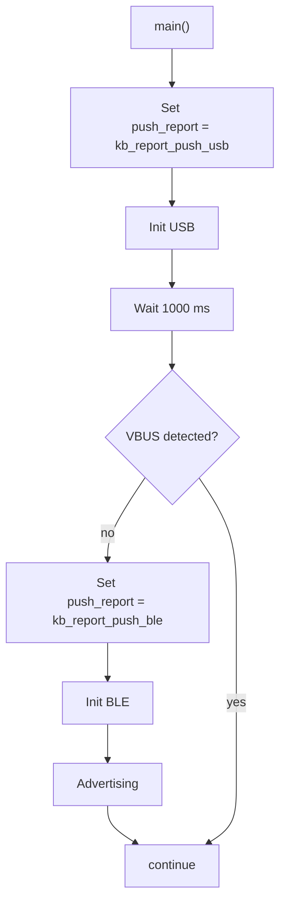

# Latest version (v1.0.0)

- Please be reminded, a [J-Link Debugger](https://www.segger.com/products/debug-probes/j-link/) is needed to flash the MCU if you are not using any [DKs by nordic](https://www.nordicsemi.com/Products/Wireless/Bluetooth-Low-Energy/Development-hardware). You should have one before proceed.

  ## IDE environment

- First, download and open the [project folder](main_firmware(52840)/) using [VS Code](https://code.visualstudio.com/) with the [nRF Connect for VS Code](https://www.nordicsemi.com/Products/Development-tools/nRF-Connect-for-VS-Code) extension and installed SDK [NCS v3.2.2](https://github.com/nrfconnect/sdk-nrf/releases/tag/v3.2.2).

- Second, download the [board .dts folder](tomertomism/), and put in inside ( ./ncs/v3.2.2/zephyr/boards/ ).

- Third, add your own Build Configuration, e.g. optimisation level, and click "Generate and Build".

- Last, click "Flash".

  ## Firmware structure
- Zephyr RTOS
  ```mermaid
  flowchart TD
    A --> B --> C
    B --> G --> D
    B --> F --> E
    A[Power On]
    B[Setup Zephyr]
    C["call main()"]
    D["Start thread kb_run_scan()"]
    E["Start thread kb_run_led()"]
    F[Wait 2000ms]
    G[Wait 1500ms]
  ```
- Firmware [main entry](main_firmware(52840)/src/main.c#L39)



- Matrix Scan [thread entry](main_firmware(52840)/src/kb_scan.c#L141)

  ```c
  typedef struct {
    const uint8_t polling_ms;
    uint8_t value;
    uint8_t media_row;
    uint8_t media_col;
    uint8_t is_qdec_ready;
    int8_t (*push_report)(uint8_t *report, uint8_t size, k_ticks_t delay);
  }__packed(kb_scan_cfg_t);
  ```
  every loop in [`kb_run_scan()`](main_firmware(52840)/src/kb_scan.c#L141), function [`scan_cfg1.push_report()`](main_firmware(52840)/src/kb_scan.c#L243) is called to either submit hid report in usb or notify report in ble.

- ARGB [thread entry](main_firmware(52840)/src/kb_led.c#L57)

  ```c
  typedef struct {
    uint8_t mode;
    uint16_t speed_delay;
    uint16_t hue_angle_seed;
    uint8_t brightness_idx;
    struct led_rgb colour[DT_PROP(DT_NODELABEL(led_strip), chain_length)];
  }__packed(kb_led_t);
  ```
  [`kb_led_mode[led_cfg1.mode]();`](main_firmware(52840)/src/kb_led.c#L93) is called in every loop to either calculate the effect or set all 0 to turn off argb.
